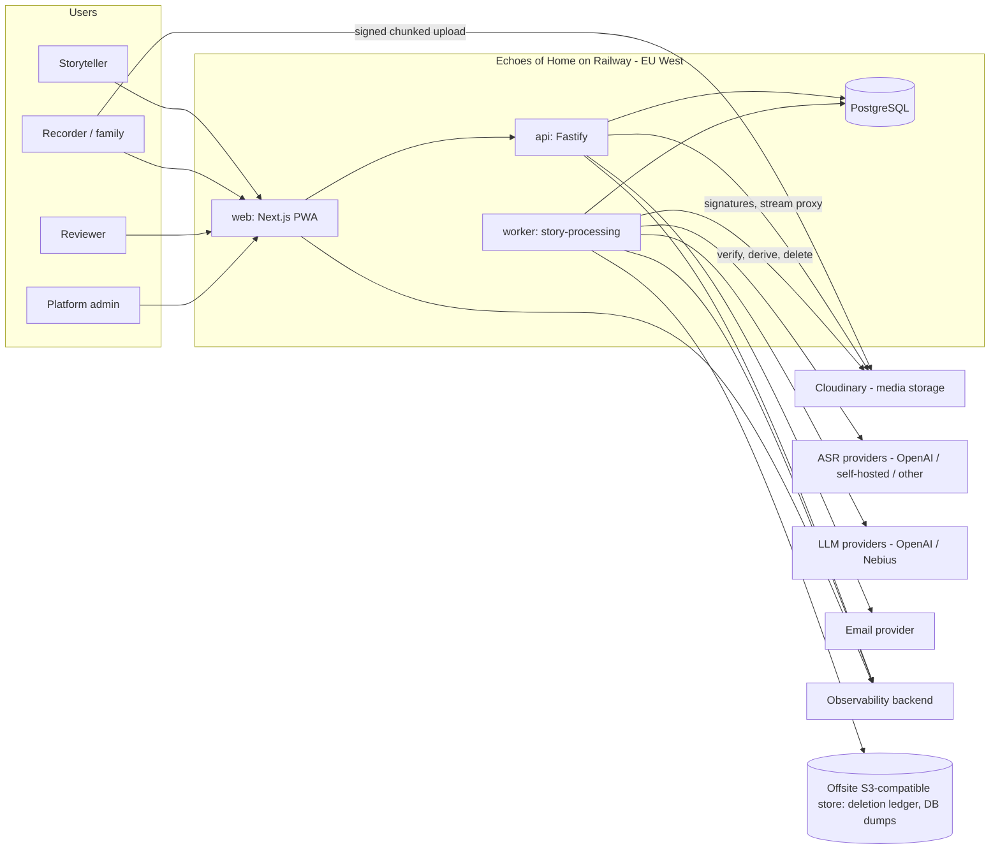
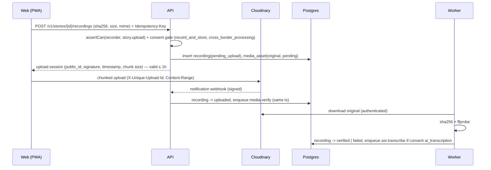
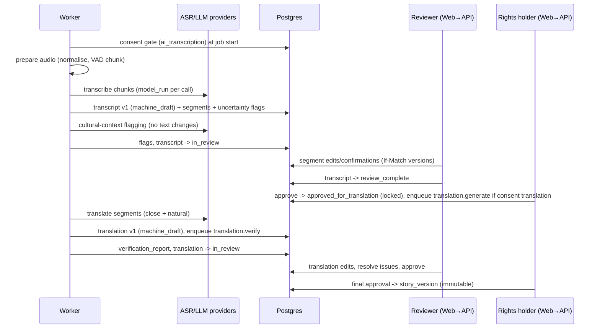

# Architecture

**Status:** Draft v1. Decisions referenced here are recorded as ADRs in `docs/decisions/`.

## 1. Architectural drivers

1. **Trust enforcement in code.** Consent, authorisation, sharing, deletion are deterministic, testable, and centralised.
2. **Source-of-truth preservation.** Original audio is immutable and integrity-checked; every derived artefact has provenance.
3. **Unproven language quality.** AI providers must be swappable and measurable; uncertainty must flow through the whole pipeline.
4. **Durable, idempotent processing.** Long audio, slow providers, retries, and withdrawals mid-flight.
5. **Low-bandwidth, mobile-first clients.**
6. **Small team, simple operations.** Fewest moving parts that meet the above (no Redis, no Kubernetes, no microservice sprawl).

## 2. System context



Trust boundaries: (1) browser ↔ API (untrusted client), (2) API/worker ↔ third-party processors (data leaves our control; contracts and minimisation apply), (3) model outputs ↔ application (model output is untrusted input), (4) admin ↔ content (no default access).

## 3. Containers (Railway services)

| Service | Tech | Responsibility | Scales |
|---|---|---|---|
| `web` | Next.js (App Router), TypeScript, Tailwind, PWA | UI, i18n, local recording buffer, upload client. **No** secrets; **no** direct DB access; no server-side data access beyond calling the API. | Horizontally (stateless) |
| `api` | Node.js LTS, Fastify, Zod, Drizzle | All user-initiated reads/writes, authorisation, consent gates, state transitions, upload signing, media streaming, webhooks, transactional job enqueue, audit events. | Horizontally (stateless) |
| `worker` | Node.js LTS, Graphile Worker, ffmpeg | Media verification, audio preparation, ASR, flagging, translation, verification, deletion, export, scheduled maintenance. | Horizontally (Postgres `SKIP LOCKED` semantics) |
| `postgres` | Railway PostgreSQL | Domain data, audit log, job queue schema. | Vertically; backups + PITR |
| `cron` (optional) | Railway cron service | Offsite `pg_dump`, ledger replication checks (or scheduled Graphile Worker tasks). | — |

Why a separate API rather than Next.js route handlers only: the worker and API share domain services; isolating the API keeps secrets and DB credentials out of the web runtime, makes authorisation testable in one place, and allows the web app to stay a pure client of a versioned API. (Trade-off: one more service to deploy.)

## 4. Monorepo packages and dependency rules

```
shared-types  ◄── validation ◄── auth ◄──────────┐
     ▲              ▲             ▲              │
     │              │             │              │
  database ◄────────┴─────────────┤              │
     ▲                            │              │
     │        media-storage       │   ai-providers
     │             ▲              │        ▲
     │             │              │        │
     │             │        agent-workflows┘
     │             │              ▲
  apps/api ────────┴──────────────┤
  workers/story-processing ───────┘
  apps/web ──► shared-types, validation (only)
```

Rules (enforced with lint boundaries in M1):

- `apps/web` imports only `shared-types` and `validation`. Never `database`, `auth` internals, providers, or SDKs.
- Provider SDKs (`openai`, `cloudinary`, etc.) are imported **only** inside `packages/ai-providers` or `packages/media-storage` adapters.
- `packages/auth` exposes `can()`/`assertCan()` and session primitives; it is the only place authorisation logic lives.
- `packages/agent-workflows` has **no** database or media access. It receives typed inputs and returns typed, validated outputs. Persistence is the worker's job.
- Domain services (state transitions, consent checks) live in `packages/database` repositories + a `domain` module inside `apps/api`/worker shared via `packages/database/domain` (see `SYSTEM_DESIGN.md` §2).

## 5. Key flows

### 5.1 Upload and verification



### 5.2 Transcription → review → translation → approval



### 5.3 Playback

Browser requests `GET /v1/stories/{id}/audio?rendition=playback` with `Range`. API authorises on every request, then streams bytes from Cloudinary using a signed URL generated server-side for that request only. The signed URL is never sent to the client (Cloudinary signed URLs do not expire and are shareable once exposed **[VERIFIED S8]**).

## 6. Technology choices (summary)

| Concern | Choice | Status | ADR |
|---|---|---|---|
| Hosting | Railway, `europe-west4-drams3a` | Provisional (data-residency review) | ADR-001 |
| DB | Railway PostgreSQL (major version: latest offered by Railway at M1, ≥ 16) | Accepted | ADR-002 |
| Media | Cloudinary authenticated delivery behind `MediaStorageProvider` | Provisional (plan tier, region) | ADR-003 |
| API | Fastify + Zod type provider + generated OpenAPI 3.1 | Proposed | ADR-007 |
| ORM | Drizzle ORM + drizzle-kit, SQL migrations reviewed by hand | Proposed | ADR-008 |
| Jobs | Graphile Worker + `processing_jobs` domain table | Proposed (spike in M0) | ADR-009 |
| AI | Provider abstraction; models selected by benchmark | Accepted (abstraction); models open | ADR-005 |
| Orchestration | Deterministic pipeline; Agents SDK not used in R1 | Proposed | ADR-006 |
| Auth | Better Auth + email-OTP plugin; server-side sessions in Postgres; preserve email link/code requirements | Selected by founder; restricted storage adapter verified (OQ-039) | ADR-010 |
| Observability | OpenTelemetry SDK → OTLP backend (vendor OQ-013), structured JSON logs | Proposed | — |
| Monorepo | pnpm workspaces + Turborepo | Proposed | — |
| Testing | Vitest, Playwright, axe-core, Testcontainers (Postgres) | Proposed | — |

## 7. What we deliberately do not use

- **Supabase** — excluded by constraint.
- **Redis/BullMQ** — avoids another stateful service; Postgres-backed queue is sufficient for pilot throughput and allows transactional enqueue.
- **Agent frameworks for core flow** — predictable workflow; agents add non-determinism without benefit (ADR-006).
- **Embeddings / vector search** — no R1 feature needs them; each additional copy of content increases deletion surface.
- **Client-side AI calls** — all model calls are server-side with secrets in the worker.

## 8. Evolution paths

- Replace Cloudinary with S3-compatible storage + own streaming (adapter swap; `MEDIA_STORAGE.md` §9).
- Add self-hosted ASR on a GPU provider if the benchmark favours open models (`AI_PROVIDER_STRATEGY.md`).
- Add search over approved, shared stories (R3+), with deletion-aware indexing.
- Add native mobile app (R4+) reusing the API.
