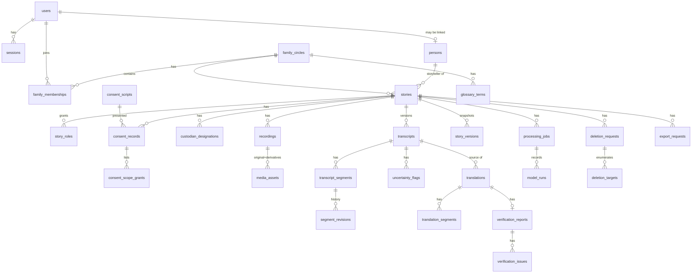

# Data Model

**Database:** Railway PostgreSQL (ADR-002). **Access:** Drizzle ORM with hand-reviewed SQL migrations (ADR-008).
**Authoritative for:** tables, columns, enums, constraints, indexes. State values must match `MACHINE.md`.

## 1. Conventions

- Primary keys: `id uuid` (UUIDv7 generated by the application for index locality). Never expose sequential IDs.
- Timestamps: `timestamptz`, UTC. Every table has `created_at`; mutable tables have `updated_at` and `version int` (optimistic concurrency).
- Enums: PostgreSQL `text` + `CHECK (col IN (...))` (easier migrations than native enums). TypeScript enums generated from `packages/shared-types`.
- Soft vs hard delete: content is **hard-deleted** by the deletion pipeline. A minimal `story_tombstones` row remains (IDs, timestamps, deletion request ID). No `deleted_at` flags on content tables.
- Sensitive columns marked 🔒 are encrypted at the application layer (AES-256-GCM, keyring `FIELD_ENCRYPTION_KEYS`) in addition to Railway volume encryption (status of Railway at-rest encryption: UNVERIFIED — OQ-008).
- Text content (transcript and translation text) is **not** application-encrypted in R1 (needed for review UX and DB-side constraints); it is protected by access control, network isolation, and storage encryption. Revisit in R4 (OQ-009).
- Foreign keys `ON DELETE RESTRICT` by default; the deletion pipeline deletes in dependency order explicitly. `ON DELETE CASCADE` only where noted (pure child rows).

## 2. Entity overview

`audit_events` reference any entity by `(entity_type, entity_id)` and intentionally have no FKs (they must survive content deletion without containing content).

## 3. Identity and families

### `users`
| Column | Type | Notes |
|---|---|---|
| id | uuid PK | |
| email 🔒 | bytea | encrypted; `email_lookup_hash bytea` (HMAC-SHA256 of normalised email) for lookup |
| email_lookup_hash | bytea UNIQUE NOT NULL | |
| display_name | text NOT NULL | 1–80 chars |
| ui_language | text NOT NULL DEFAULT 'xh' | CHECK IN ('xh','en') |
| account_role | text NOT NULL DEFAULT 'member' | CHECK IN ('member','platform_admin') |
| status | text NOT NULL DEFAULT 'active' | CHECK IN ('active','closing','closed') |
| created_at, updated_at, version | | |

### `sessions`
| Column | Type | Notes |
|---|---|---|
| id | uuid PK | |
| user_id | uuid FK users ON DELETE CASCADE | |
| token_hash | bytea UNIQUE NOT NULL | SHA-256(token ‖ pepper); raw token only in cookie |
| created_at, last_seen_at, expires_at | timestamptz | absolute + idle expiry enforced in code |
| revoked_at | timestamptz NULL | |
| user_agent_summary | text NULL | coarse ("Android · Chrome"), no full UA string |

Index: `(user_id) WHERE revoked_at IS NULL`.

### `auth_challenges`
One-time sign-in link/code. `id`, `email_lookup_hash`, `code_hash`, `link_token_hash`, `expires_at` (10 min), `consumed_at`, `attempts int` (max 5), `created_ip_hash` (HMAC, for rate limiting only; purged after 24 h).

### `persons`
| Column | Type | Notes |
|---|---|---|
| id | uuid PK | |
| display_name 🔒 | bytea | encrypted; storyteller names are sensitive in context |
| preferred_language | text NOT NULL | CHECK IN ('xh','en') |
| linked_user_id | uuid NULL UNIQUE FK users | set when storyteller links own account |
| created_by_user_id | uuid FK users | |
| adult_attested_at | timestamptz NULL | FR-PER-03 (yes/no attestation only) |
| contact_email 🔒 | bytea NULL | optional |
| created_at, updated_at, version | | |

### `family_circles`
`id`, `name` (1–80), `created_by_user_id`, timestamps, version.

### `family_memberships`
`id`, `family_circle_id` FK CASCADE, `user_id` FK, `circle_role` CHECK IN ('family_admin','family_member'), `created_at`.
UNIQUE `(family_circle_id, user_id)`. Invariant "≥ 1 family_admin" enforced in service + deferred constraint trigger.

### `invitations`
`id`, `type` CHECK IN ('family_member','story_reviewer','custodian','storyteller_account_link'), `token_hash` UNIQUE, `invited_email_lookup_hash`, `family_circle_id` NULL, `story_id` NULL, `person_id` NULL, `role_payload jsonb` (e.g. `{"roles":["transcript_reviewer"]}` validated by Zod), `status` CHECK IN ('pending','accepted','expired','revoked'), `expires_at` (7 days), `created_by_user_id`, `accepted_by_user_id` NULL, timestamps.

## 4. Stories, roles, consent

### `stories`
| Column | Type | Notes |
|---|---|---|
| id | uuid PK | |
| family_circle_id | uuid FK NOT NULL | |
| storyteller_person_id | uuid FK persons NOT NULL | immutable after creation (trigger) |
| rights_holder_person_id | uuid FK persons NOT NULL | defaults to storyteller; switches when custodian active |
| created_by_user_id | uuid FK users | recorder |
| title 🔒 | bytea NULL | encrypted (titles can be revealing) |
| description 🔒 | bytea NULL | |
| source_language | text NOT NULL DEFAULT 'xh' | CHECK IN ('xh') in R1 |
| target_language | text NULL DEFAULT 'en' | CHECK IN ('en') |
| status | text NOT NULL DEFAULT 'draft' | `MACHINE.md` §1 values |
| paused_from_status | text NULL | |
| attention_reason | text NULL | CHECK IN ('transcription_not_consented','transcription_failed','translation_failed','budget_wait','verification_incomplete') |
| audience | text NOT NULL DEFAULT 'private' | CHECK IN ('private','family','public') |
| current_story_version_id | uuid NULL FK story_versions | |
| created_at, updated_at, version | | |

Constraints: `CHECK (audience = 'private' OR current_story_version_id IS NOT NULL)`.
Indexes: `(family_circle_id, status)`, `(storyteller_person_id)`, `(rights_holder_person_id)`.

### `story_roles`
`id`, `story_id` FK CASCADE, `user_id` FK, `role` CHECK IN ('recorder','transcript_reviewer','translation_reviewer','viewer'), `granted_by_user_id`, `granted_at`, `revoked_at` NULL.
UNIQUE `(story_id, user_id, role) WHERE revoked_at IS NULL`.
`viewer` = explicitly granted private collaborator (FR-SHR-01).

### `consent_scripts`
Versioned explanation content. `id`, `language` CHECK IN ('xh','en'), `version` text (semver), `content_hash` bytea (SHA-256 of canonical JSON of cards + audio asset hashes), `content jsonb` (card text keys), `audio_media_asset_ids uuid[]`, `processors_disclosed jsonb` (list of named processors + regions shown), `approved_by` text (human reviewer names/roles recorded for provenance), `published_at`. UNIQUE `(language, version)`. Immutable after publish (trigger).

### `consent_records`
| Column | Type | Notes |
|---|---|---|
| id | uuid PK | |
| story_id | uuid FK | |
| storyteller_person_id | uuid FK | redundant for audit clarity |
| status | text | CHECK IN ('active','superseded','withdrawn') |
| method | text NOT NULL | CHECK IN ('self_digital','assisted_verbal') |
| consent_script_id | uuid FK consent_scripts | what was presented |
| presented_language | text | 'xh' / 'en' |
| operated_by_user_id | uuid FK users | who held the device (storyteller's own user for self) |
| evidence_media_asset_id | uuid NULL FK media_assets | required when `method='assisted_verbal'` (CHECK) |
| comprehension_result | jsonb NOT NULL | `{ "questions": 3, "correct": n, "reexplained": bool }` |
| rights_holder_choice | text | CHECK IN ('self','custodian') |
| supersedes_id | uuid NULL FK consent_records | |
| change_kind | text | CHECK IN ('initial','grant','revoke','withdraw_all') |
| created_at, superseded_at, withdrawn_at | | |

Indexes/constraints:
- `UNIQUE (story_id) WHERE status = 'active'`
- `CHECK (method <> 'assisted_verbal' OR evidence_media_asset_id IS NOT NULL)`
- Trigger: rows immutable except transitions of `status` with matching timestamp columns.

### `consent_scope_grants`
`consent_record_id` FK CASCADE, `scope` CHECK IN ('record_and_store','cross_border_processing','ai_transcription','human_review','translation','share_family','share_public','model_training'), `granted boolean NOT NULL`. PK `(consent_record_id, scope)`.
R1 service rule: `share_public` and `model_training` must be `false`.

### `custodian_designations`
`id`, `story_id` FK, `custodian_user_id` FK users, `custodian_person_id` FK persons (created/linked for the custodian), `status` CHECK IN ('pending_acceptance','active','revoked'), `designated_in_consent_record_id` FK, `accepted_at`, `revoked_at`.
UNIQUE `(story_id) WHERE status IN ('pending_acceptance','active')`.

## 5. Media

### `recordings`
`id`, `story_id` FK, `status` (`MACHINE.md` §2), `source` CHECK IN ('browser_recording','file_upload'), `declared_sha256` bytea NOT NULL, `declared_size_bytes` bigint, `declared_mime` text, `verified_sha256` bytea NULL, `duration_ms` int NULL, `codec` text NULL, `failure_reason` text NULL CHECK IN ('hash_mismatch','no_audio_stream','too_long','unsupported_format','provider_error'), `upload_expires_at`, timestamps, version.
UNIQUE `(story_id) WHERE status NOT IN ('failed','abandoned','deleted')` (one live recording per story in R1).

### `media_assets`
| Column | Type | Notes |
|---|---|---|
| id | uuid PK | |
| story_id | uuid FK | for deletion enumeration |
| recording_id | uuid NULL FK | NULL for consent evidence and consent-script audio |
| role | text | CHECK IN ('original','playback','processing','consent_evidence','consent_script_audio','export_archive') |
| provider | text | CHECK IN ('cloudinary','fake') |
| provider_public_id | text NOT NULL | random, non-identifying (no names/titles in IDs or folders) |
| provider_resource_type | text | 'video' for audio on Cloudinary **[VERIFIED S7]**, 'raw' for archives |
| provider_delivery_type | text | 'authenticated' |
| sha256 | bytea NULL | for originals and evidence |
| size_bytes | bigint NULL | |
| status | text | CHECK IN ('pending','available','failed','deleting','deleted') |
| derived_from_asset_id | uuid NULL FK media_assets | provenance |
| created_at, deleted_at | | `deleted_at` set by pipeline before row removal confirmation |

UNIQUE `(provider, provider_public_id)`. Index `(story_id, role)`.

## 6. Transcripts and review

### `transcripts` (versions)
`id`, `story_id` FK, `recording_id` FK, `version_number int`, `status` (`MACHINE.md` §3), `derived_from_transcript_id` NULL FK, `asr_processing_job_id` FK, `approved_by_user_id` NULL, `approved_at` NULL, `content_hash` bytea NULL (SHA-256 over canonical segments at approval), timestamps, version.
- UNIQUE `(story_id, version_number)`
- UNIQUE `(story_id) WHERE status IN ('generating','machine_draft','in_review','review_complete')`
- Trigger: when `status = 'approved_for_translation'`, its segments become immutable.

### `transcript_segments`
| Column | Type | Notes |
|---|---|---|
| id | uuid PK | |
| transcript_id | uuid FK CASCADE | |
| ordinal | int | UNIQUE `(transcript_id, ordinal)` |
| start_ms, end_ms | int | CHECK `0 ≤ start_ms < end_ms` |
| text | text NOT NULL | current text ('' when inaudible) |
| machine_text | text NOT NULL | original ASR output, never modified |
| detected_languages | text[] | e.g. `{xh,en}` |
| asr_confidence | real NULL | provider-specific; **not comparable across providers** |
| review_state | text | `MACHINE.md` §4 |
| exclusion_reason | text NULL | |
| current_revision | int NOT NULL DEFAULT 0 | |
| version | int | optimistic concurrency |

### `segment_revisions`
`id`, `segment_id` FK CASCADE, `revision int`, `text`, `review_state`, `author_user_id` NULL (NULL = system), `created_at`. UNIQUE `(segment_id, revision)`.

### `uncertainty_flags`
`id`, `transcript_id` FK CASCADE, `segment_id` FK CASCADE, `char_start int NULL`, `char_end int NULL` (span within `machine_text`/`text` at creation; NULL = whole segment), `reason` (FR-UNC-01 codes), `source` CHECK IN ('asr_signal','heuristic','context_assist','dual_asr','reviewer'), `suggestion_text` NULL (never auto-applied), `question_for_reviewer` NULL, `status` (`MACHINE.md` §5), `resolved_by_user_id` NULL, `resolution_note` NULL, `model_run_id` NULL FK, timestamps.
Index `(transcript_id, status)`.

### `glossary_terms`
`id`, `family_circle_id` FK, `term` text, `category` CHECK IN ('person_name','clan_name','praise_name','place','kinship_term','idiom','other'), `explanation_en` NULL, `explanation_xh` NULL (human-written only), `status` CHECK IN ('proposed','approved','retired'), `proposed_by_user_id`, `approved_by_user_id` NULL, `source_story_id` NULL, timestamps.
UNIQUE `(family_circle_id, lower(term), category) WHERE status <> 'retired'`.
Only `approved` terms are used as ASR keyword hints or translation constraints (FR-CTX-02).

## 7. Translation and verification

### `translations` (versions)
`id`, `story_id` FK, `source_transcript_id` FK transcripts NOT NULL, `target_language` 'en', `version_number`, `status` (`MACHINE.md` §7), `approved_by_user_id`, `approved_at`, `content_hash`, `rejection_reason` NULL, timestamps, version.
**DB guard:** trigger `BEFORE INSERT` raises unless `source_transcript_id` has `status = 'approved_for_translation'` (FR-TRN-01). Service layer checks the same and returns `409 transcript_not_approved`.

### `translation_segments`
`id`, `translation_id` FK CASCADE, `source_segment_id` FK transcript_segments, `close_text`, `natural_text`, `machine_close_text`, `machine_natural_text`, `render_mode` CHECK IN ('normal','unclear_marker','inaudible_marker'), `review_state` CHECK IN ('unreviewed','reviewed','edited'), `version`.
UNIQUE `(translation_id, source_segment_id)` — exactly one per source segment (excluded source segments are not included; checked at `machine_draft` transition).

### `verification_reports`
`id`, `translation_id` FK UNIQUE, `status` CHECK IN ('complete','incomplete'), `checks_run jsonb` (list of check IDs + versions), `created_at`.

### `verification_issues`
`id`, `report_id` FK CASCADE, `translation_segment_id` NULL FK, `check_id` text (e.g. `num.mismatch`, `name.missing`, `llm.omission`), `severity` CHECK IN ('blocking','warning'), `detail jsonb` (no free-form model prose stored beyond 500 chars), `status` CHECK IN ('open','resolved','dismissed'), `dismiss_reason` NULL, `resolved_by_user_id` NULL, timestamps.

## 8. Story versions

### `story_versions`
`id`, `story_id` FK, `version_number`, `transcript_id` FK (must be `approved_for_translation`), `translation_id` NULL FK (must be `approved` if present), `status` CHECK IN ('approved','superseded','withdrawn'), `approved_by_user_id`, `approved_at`, `snapshot_hash` bytea (hash of transcript content_hash ‖ translation content_hash ‖ metadata), `accepted_uncertainty_count int`.
UNIQUE `(story_id, version_number)`; UNIQUE `(story_id) WHERE status = 'approved'`.

## 9. Processing and provenance

### `processing_jobs`
| Column | Type | Notes |
|---|---|---|
| id | uuid PK | also the Graphile `job_key` |
| story_id | uuid NULL FK | NULL for maintenance jobs |
| type | text | `MACHINE.md` §6 list |
| status | text | `MACHINE.md` §6 |
| input_ref | jsonb | IDs only (e.g. `{ "recordingId": "…" }`) |
| attempts | int DEFAULT 0 | |
| max_attempts | int | per type |
| last_error_code | text NULL | stable codes, no content |
| correlation_id | text | from originating request |
| idempotency_key | text UNIQUE | `type:entity_id:version` |
| created_at, started_at, finished_at | | |

Index `(story_id, type, status)`, `(status, created_at)`.

### `model_runs`
`id`, `processing_job_id` FK, `role` CHECK IN ('listener_asr','listener_asr_secondary','context_assist','translator','verifier'), `provider`, `model_id`, `model_version_label` NULL (snapshot/date if exposed), `prompt_id` NULL, `prompt_version` NULL, `params jsonb` (temperature, language hints — no content), `input_sha256`, `output_sha256` NULL, `input_units` (seconds or tokens), `output_units`, `cost_usd_micros bigint`, `latency_ms`, `outcome` CHECK IN ('ok','schema_invalid','provider_error','timeout','refused','cancelled'), `provider_request_id` NULL, `created_at`.
Index `(provider, model_id, created_at)`.

### `cost_budgets` / usage
`ai_usage_daily (date, provider, cost_usd_micros)` maintained transactionally from `model_runs` for budget checks; per-story totals computed from `model_runs`.

## 10. Audit, deletion, export, admin

### `audit_events` (append-only)
`id` bigserial (ordering), `occurred_at`, `actor_type` CHECK IN ('user','system','platform_admin'), `actor_user_id` NULL, `action` text (catalog in `SECURITY_AND_PRIVACY.md` §8), `entity_type`, `entity_id uuid`, `story_id` NULL, `metadata jsonb` (IDs, old/new state names; **no content**), `correlation_id`, `prev_hash bytea`, `hash bytea` (HMAC-SHA256 over canonical event ‖ prev_hash with `AUDIT_HMAC_KEY`).
Privileges: application role has `INSERT, SELECT` only; `UPDATE/DELETE` revoked. On story deletion, `metadata` for that story's events is reduced to state names (already content-free) — events remain.

### `deletion_requests`
`id`, `story_id` NULL (NULL for account-level), `user_id` NULL, `scope` CHECK IN ('story','account'), `requested_by_user_id`, `reason_code` CHECK IN ('user_request','consent_withdrawn','account_closure','admin_legal'), `status` (`MACHINE.md` §12), `immediate boolean`, `execute_after`, timestamps.

### `deletion_targets`
`id`, `deletion_request_id` FK, `target_type` CHECK IN ('media_asset','media_backup_versions','db_rows','provider_copy_notice','export_archive','offsite_dump_note','local_device_notice'), `target_ref jsonb`, `status` CHECK IN ('pending','done','failed_retryable','failed_permanent','not_applicable'), `attempts`, `last_error_code`, `completed_at`.

### `story_tombstones`
`story_id` PK, `deleted_at`, `deletion_request_id`. No other data. Also replicated to the offsite deletion ledger (`RETENTION_AND_DELETION.md` §6).

### `export_requests`
`id`, `story_id` FK, `requested_by_user_id`, `status`, `media_asset_id` NULL (role `export_archive`), `download_token_hash`, `expires_at`, `purge_after`, timestamps.

### `break_glass_grants`
`id`, `admin_user_id`, `story_id`, `reason` (≥ 20 chars), `expires_at` (≤ 60 min), `revoked_at`, `created_at`. Every content read under a grant writes an audit event.

### Infrastructure tables
- `idempotency_keys`: `(key, user_id)` PK, `request_hash`, `response_status`, `response_body jsonb`, `created_at` (TTL 24 h).
- `webhook_receipts`: `(provider, provider_event_id)` PK, `received_at` — dedupe signed provider notifications.
- `job_step_results`: `(processing_job_id, step_kind, step_index)` PK, `step_kind` CHECK IN ('asr_chunk','translation_batch','verify_batch'), `result jsonb` (validated output), `model_run_id`, `created_at`. Lets retries skip completed provider calls (`SYSTEM_DESIGN.md` §4.3). Deleted when the job reaches a terminal state and outputs are persisted, and by the deletion pipeline.
- `worker_heartbeats`: `worker_id` PK, `last_seen_at` — liveness for alerts (`OBSERVABILITY.md` §8).
- `graphile_worker.*`: owned by Graphile Worker migrations; not modified by application migrations.

## 11. Ownership and access rules (data-level)

| Data | Who can read | Who can write |
|---|---|---|
| Story metadata | storyteller, rights holder, recorder, reviewers, viewers; family members if audience=`family` and version approved | rights holder; recorder (title/description until first approval) |
| Original audio | storyteller, rights holder (export only) | system |
| Playback audio | anyone who can read the story | system |
| Transcript segments (in review) | storyteller, rights holder, transcript reviewers | transcript reviewers, rights holder |
| Translation (in review) | storyteller, rights holder, translation reviewers | translation reviewers, rights holder |
| Approved story version | per audience rules | — (immutable) |
| Consent records | storyteller, rights holder | storyteller (grant/revoke/withdraw), rights holder (revoke/withdraw only) |
| Audit log (story) | storyteller, rights holder | system only |
| Glossary | family circle members (approved terms); proposer | members propose; rights holder of the source story approves |

All enforced by `packages/auth` policies; the table is a summary — the policy matrix in `CONSENT_AND_OWNERSHIP.md` §5 is authoritative.

## 12. Migration and data-integrity tests (required)

- Clean migrate up from empty DB in CI; migrations are forward-only; destructive changes use expand → migrate → contract across releases.
- Constraint tests for: one active consent per story; assisted consent requires evidence; translation insert blocked unless transcript approved; one live transcript version; one approved story version; audience private without version; audit table update/delete denied for app role.
